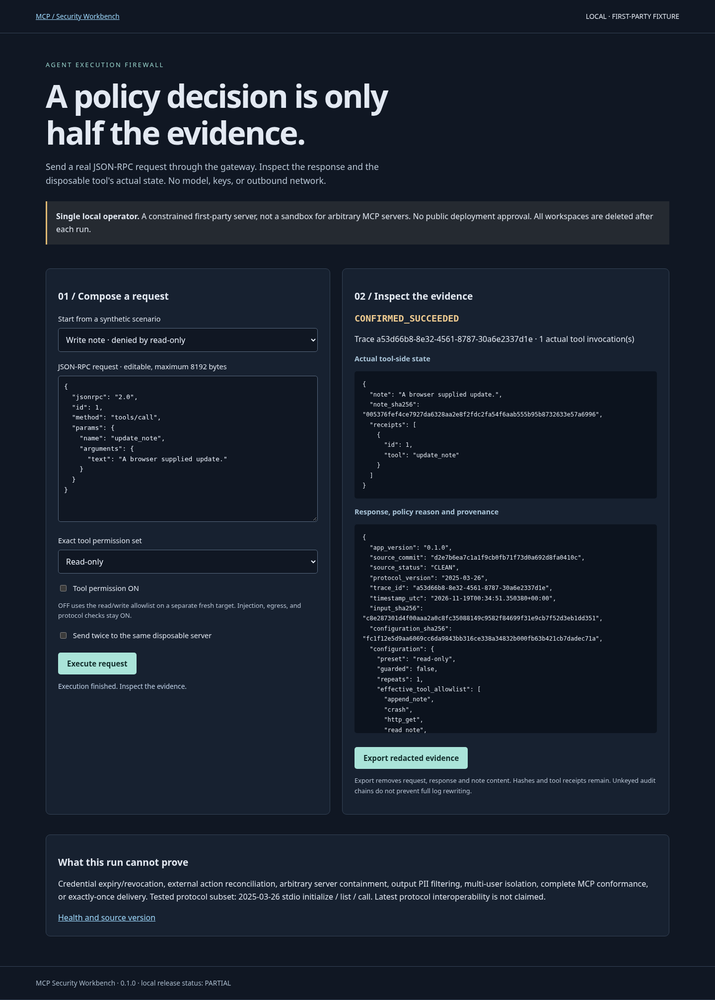

# MCP Agent Security Gateway

A local workbench for agent developers to compose MCP requests, change tool permissions and inspect actual tool-side outcomes. The browser calls the repository's `PolicyEngine` and `StdioMCPProxy`, which invoke a fixed first-party stdio subprocess in a disposable workspace. No model or provider account is needed.

**Release decision: PARTIAL.** The demonstrated workflow works within its bounded fixture scope. Credential lifecycle, arbitrary-server containment, external action reconciliation, response PII filtering and complete current MCP conformance remain missing or unverified. No production release or deployment is approved.

## Start locally

Prerequisites: Python 3.10 or newer, pip and a browser. Git is needed for checkout provenance and some development tests. Initial installation may download packaging tools; Python 3.10 also needs the declared `tomli` compatibility dependency. No API keys or paid services are required.

```sh
python -m venv .venv
. .venv/bin/activate
python -m pip install -e .
python -m mcp_monitor.workbench
```

On Windows PowerShell, activate with `.venv\Scripts\Activate.ps1`. Open **http://127.0.0.1:8761**. If that port is occupied, use `python -m mcp_monitor.workbench --port 8765` and open the printed address. The service binds only to IPv4 loopback and accepts its exact origin. Do not expose it through a tunnel or reverse proxy. Stop with Ctrl+C.

## Complete a real task

1. Execute **Read sample note**. Inspect the completed tool response, receipt and independently read note hash.
2. Choose **Write note · denied by read-only**. Keep **Read-only** and **Tool permission ON**, then execute. The result is `NOT_INVOKED`, with no tool receipt.
3. Keep the request unchanged and turn **Tool permission OFF**. Execute again. A separate fresh target receives the same request with the read/write allowlist; inspect the changed note and receipt.
4. Select **Export redacted evidence**. The download removes raw request, response and note content, retaining configuration, hashes and receipts. Review metadata before sharing.

OFF changes only the exact tool allowlist; injection, egress and protocol checks stay enabled. Each run starts with the same labeled synthetic note and removes its child/workspace before the normal response completes. There is no incident database or guarantee of secure erasure.



This screenshot is from tested implementation source `4b6bb486d83f4410037113e64848a22e4a06f713`. Its evidence archive is not a software release.

## Supported scope and uncertainty

- Editable JSON-RPC reaches the actual engine and real first-party subprocess.
- Exact read/write permissions, independent state hashes and invocation receipts support the outcome.
- Existing controls exercise injection-in-arguments denial, disallowed destinations, fixed-path cross-workspace refusal, malformed requests and alternate-method rejection.
- Crash and timeout cases return explicit uncertainty; repeated append demonstrates duplicate effects.
- The tested MCP **2025-03-26 stdio subset** covers initialize, initialized notification, tools/list, tools/call and ping. Latest-version interoperability, full conformance, cancellation and concurrent-request semantics are **NOT VERIFIED**.

The operator cannot select a server executable, host path or outbound connection. This controlled child is not an OS sandbox for arbitrary servers. A policy ALLOW is not proof of execution. Reports distinguish `NOT_INVOKED`, `CONFIRMED_SUCCEEDED`, `CONFIRMED_FAILED` and `UNKNOWN / REQUIRES_RECONCILIATION`. Unkeyed audit chains do not resist a complete log rewrite. Only operations routed through an enforcing integration receive its controls.

## Verification and evidence

The last published implementation-source run is explicitly scoped to **`4b6bb486d83f4410037113e64848a22e4a06f713`**: **829 passed, zero skipped, 81.80446084185813% statement coverage**, with the unchanged 77% coverage gate. The focused independent review and six associated hosted workflows passed at that source. These results do not attest to later documentation commits.

- [Published assessment, exact commands and limitations](https://github.com/poojakira/mcp-agent-security-gateway/blob/d0d78a97802b203a9652b7fceb50acc0711a66e1/release-evidence/RELEASE_ASSESSMENT.md)
- [Published source-scoped manifest](https://github.com/poojakira/mcp-agent-security-gateway/blob/d0d78a97802b203a9652b7fceb50acc0711a66e1/release-evidence/manifest.json)
- [Current verification procedure and new-head evidence status](docs/EVIDENCE.md)
- [Review proposal: PR #194](https://github.com/poojakira/mcp-agent-security-gateway/pull/194)

New-head verification is pending until a freshly executed manifest identifies that exact commit. The planned non-release archive is `evidence/docs-reconciliation-20261118`; this name alone does not establish that it exists or that checks passed.

## Develop and verify

```sh
python -m pip install -r requirements-workbench-test.txt
python -m pip install -e .
PYTHONPATH=src python -m pytest tests/ -q --cov=mcp_monitor --cov-fail-under=77
ruff check src/ tests/ scripts/workbench_e2e.py scripts/workbench_manifest.py poster/render_poster.py scripts/recruiter_demo.py
ruff format --check src/ tests/ scripts/workbench_e2e.py scripts/workbench_manifest.py poster/render_poster.py scripts/recruiter_demo.py
PYTHONPATH=src python scripts/workbench_e2e.py --output /tmp/mcp-workbench-evidence --chromium /usr/bin/chromium
python -m build
```

Chromium must exist at the supplied path. The browser harness starts its own server on an available loopback port and tears it down; it does not reuse an operator's running server. The direct tooling requirements are not a complete transitive lock. See [the developer checks](docs/WORKBENCH.md#developer-checks-and-adversarial-review) and [operations](RUNBOOK.md) for prerequisites, limits and failure recovery.

## Documentation index

| Task | Document |
|---|---|
| Product scope, architecture, threat boundaries, browser guide and acceptance matrix | [Local workbench](docs/WORKBENCH.md) |
| Startup/shutdown, data lifecycle, failures and rollback | [Runbook](RUNBOOK.md) |
| Workbench and separate HTTP-service endpoints | [API and versioning](docs/API_VERSIONING.md) |
| Security reporting and residual risk | [Security policy](SECURITY.md), [threat model](THREAT_MODEL.md) |
| Tests, exact-source evidence, branch disposition and release gates | [Evidence](docs/EVIDENCE.md), [verified snapshots](VERIFIED_METRICS.md), [release governance](PRODUCTION.md) |
| Authorized development and contribution terms | [Contributing](CONTRIBUTING.md), [license](LICENSE) |
| All-document review dispositions and externally unverified claims | [Documentation audit](docs/DOCUMENTATION_AUDIT.md) |
| User-facing changes | [Changelog](CHANGELOG.md) |

The optional authenticated inspection service, legacy dashboards, detection lab and native ports are separate integration surfaces, not proof that this browser workbench supports their capabilities. Historical reports retain their own dates/source bounds. Unique protected-server/journal/revocation work remains preserved and unmerged.
