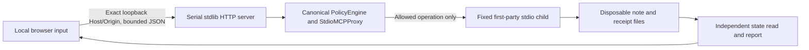

# Threat model

## Local workbench boundary

Assets are the operator host, request contents, policy configuration, temporary tool state and exported evidence. The intended actor is one trusted local developer. Untrusted inputs include JSON-RPC strings, arguments and browser-origin requests; a local OS adversary may also contact loopback or inspect files/process memory.

| Threat | Implemented control / evidence pointer | Residual risk |
|---|---|---|
| External page submits local requests | Exact loopback peer/Host/Origin and restrictive CSP in `workbench/__main__.py`; HTTP boundary tests in `test_workbench.py` | Loopback is not authentication against other local processes |
| Arbitrary executable/path/network request | Fixed child command, minimal environment, exact fixture path and tool inventory in `workbench/runtime.py` and `tool_server.py` | Trusted child is not a sandbox for arbitrary malicious code or kernel exploits |
| Unauthorized tool use | Exact tool allowlist in `PolicyEngine`, real denied-write and permission-comparison tests | No verified credential identity or cross-user authority |
| Malformed/ambiguous MCP message | Canonical proxy parsing, strict supported method boundary, duplicate-key/JSON-RPC regressions | Complete MCP conformance and concurrent/cancellation semantics unverified |
| Prompt-injection content | Existing argument detector and policy denial tests | Heuristic matches can be evaded; indirect output injection and full PII filtering absent in this flow |
| Local resource exhaustion | 16 KiB envelope, 8 KiB request, 2 KiB note changes, 30 requests/minute, serial processing, socket/operation timeouts | Slow local clients can occupy the serial service; no multi-tenant availability isolation |
| Stale or fabricated success | Actual child response, receipt, independent state and explicit UNKNOWN on missing confirmation | Compromised host can forge all local evidence; no external reconciliation |
| Repeated side effects | Repeat option records actual duplicate append receipts | No exactly-once guarantee or provider idempotency contract |
| Data leakage/tampering | Transient workspace, text rendering, redacted downloads; browser redaction/CSP tests | Deletion is not secure erasure; downloads persist; unkeyed chains permit complete rewrite |

## Distinct library and HTTP-service surfaces

The repository also contains heuristic PII/exfiltration detectors, server registration, supplied-event process/egress policy evaluation, optional manifest HMAC/drift/canary logic, HTTP API-key authentication and fingerprinted identity telemetry. Their existence does not extend the workbench's supported browser scope. The [HTTP API](docs/API_VERSIONING.md) authenticates inspection/metrics; an integrating caller must honor its decision before acting.

The named `INJECTION_PATTERNS` collection has 69 entries at implementation source `4b6bb486d83f4410037113e64848a22e4a06f713`; it is a source-inventory count, not a recall rate. Egress policy does not intercept packets. Supplied process events are not an OS sandbox. Optional host/eBPF code is not proof of deployed kernel enforcement. Test suites and source paths are mapped in [the workbench acceptance matrix](docs/WORKBENCH.md#acceptance-status-matrix).

The HTTP service uses a process-wide rate limit and trusted configuration. Source attribution trusts the socket peer unless an explicitly trusted proxy supplies a normalized forwarding value. Misconfigured ingress can spoof that context. Fingerprints depend on secret/salt custody and remain linkable metadata; local generation does not prove external ingestion or privacy compliance. Operational endpoints deliberately remain unauthenticated. See [RUNBOOK.md](RUNBOOK.md) and [SECURITY.md](SECURITY.md).

## Evidence limits and next gates

A policy ALLOW does not prove downstream success; a successful CI run does not prove security effectiveness. The workbench outcome/receipt tests cover named bounded cases. Representative adversarial/benign evaluation, current-protocol conformance, authenticated identity lifecycle, arbitrary server containment, durable external effects, audit anchoring, load/abuse isolation and deployment-specific review remain release gates. No live incident reduction, universal prevention or production approval is claimed.
