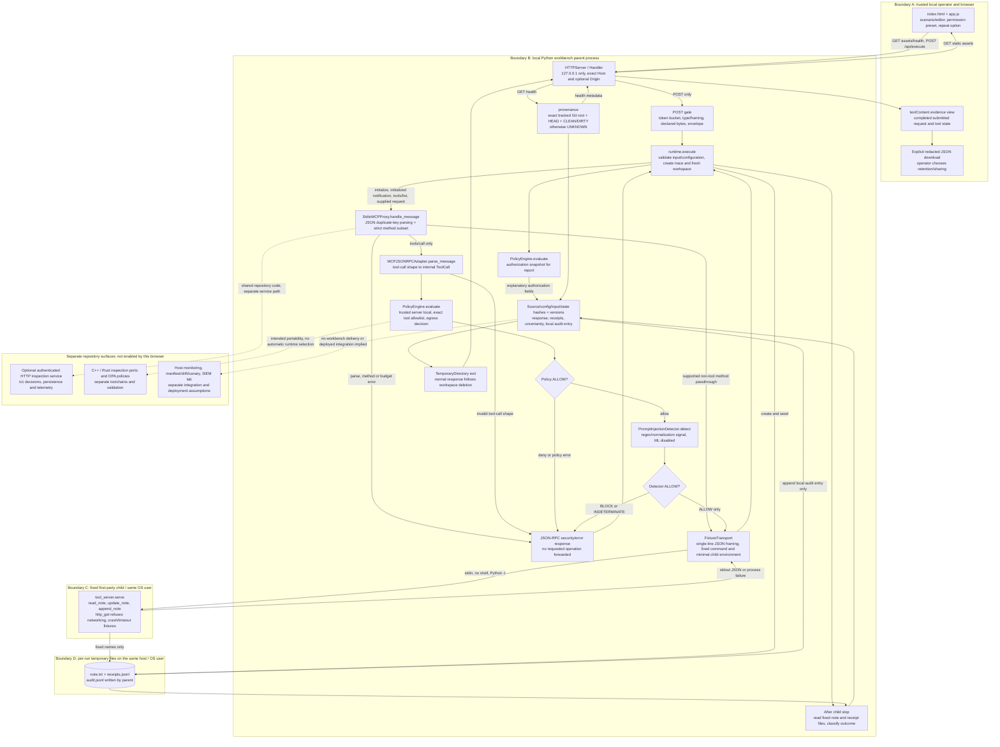
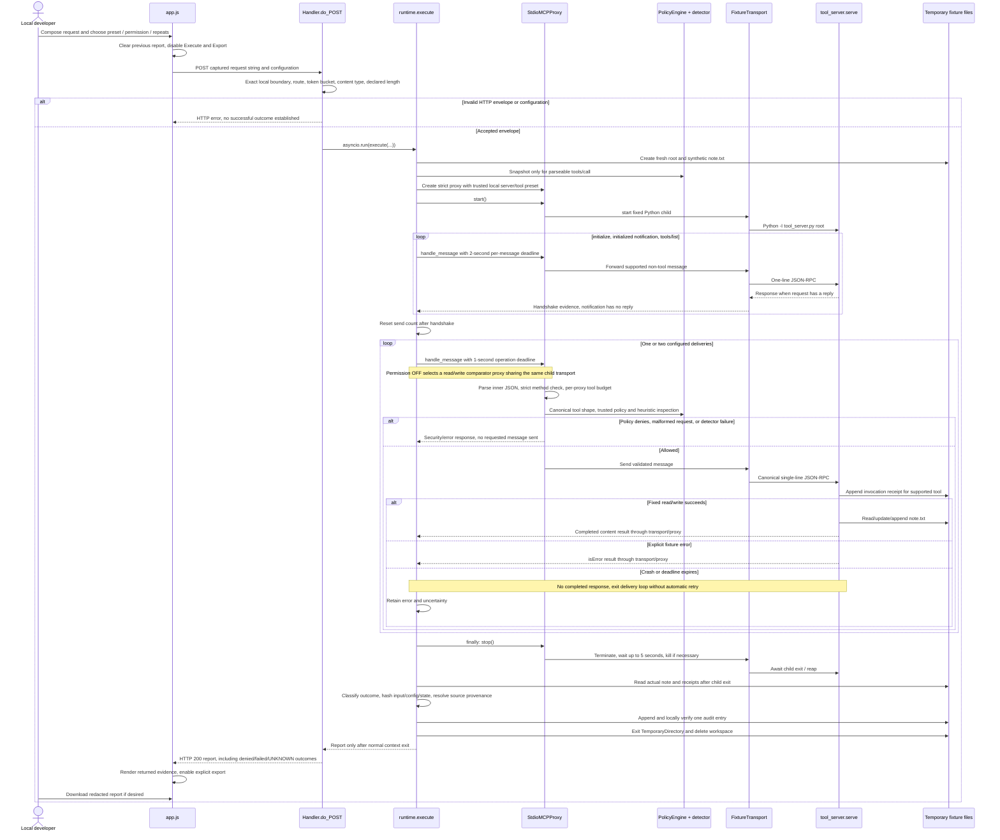

# MCP execution workbench architecture

This document maps the checked-in local browser workflow to its actual code. It describes implementation boundaries, not a new test result or production approval. The [workbench guide](WORKBENCH.md), [API reference](API_VERSIONING.md), [runbook](../RUNBOOK.md) and [source-scoped evidence](EVIDENCE.md) provide the corresponding task and verification guidance.

The supported user is one trusted local developer. A supplied MCP request goes through the existing policy/proxy and a **fixed first-party stdio child**; the report includes the actual response and independently read fixture state. No model provider, account key, database or external network service participates. Release status remains **PARTIAL**.

## Components and trust boundaries

Solid arrows are the implemented workbench request/data path. Dotted relationships identify separate optional code surfaces; they are not browser integrations. The child-process boundary is a process separation, **not an OS sandbox for arbitrary servers**.

`authorization_decision` is an explanatory policy snapshot. The proxy re-evaluates the trusted policy on the forwarded path; the snapshot alone does not authorize execution. The UI contains no detection logic. It renders the returned report using `textContent` and performs only export-field redaction.

The temporary directory is created by the parent with `tempfile.TemporaryDirectory`. The child receives that fixed root as a command argument and working directory. Request arguments cannot choose an executable or arbitrary host path. The child runs as the same OS user: isolated Python import mode, a minimal environment and a fixed program do not establish kernel, filesystem, syscall or network containment for malicious code.

## Actual execution sequence

Each POST creates a new workspace and child. The ON/OFF comparison therefore uses separate targets across runs. Within a single POST, the optional two deliveries share that one target and can produce duplicate append effects.

This sequence describes the ordinary single-object workbench path. The canonical proxy also contains batch handling; the fixed child is not a full general MCP implementation. A method appearing in a supported set does not establish complete conformance, cancellation handling or concurrent-request correctness.

## Code-to-responsibility map

| Component / symbol | Responsibility | Important boundary |
|---|---|---|
| [`create_server`, `Handler.boundary`, `Handler.do_POST`](../src/mcp_monitor/workbench/__main__.py) | Serial loopback HTTP service, envelope validation and dispatch | Loopback/Origin checks are not authentication against other local processes |
| [`execute`, `PRESETS`](../src/mcp_monitor/workbench/runtime.py) | Fresh workspace, fixed target, handshake, selected permissions, deadlines, observations and report | No user-selected executable, network client or durable incident store |
| [`FixtureTransport.start`, `send`, `stop`](../src/mcp_monitor/workbench/runtime.py) | Fixed subprocess environment/cwd, newline framing, delivery counting and final reaping | `tool_sends` counts forwarded messages after handshake; it is not proof of success |
| [`StdioMCPProxy.handle_message`, `_inspect`](../src/mcp_monitor/proxy/stdio_proxy.py) | Strict method boundary; parse, authorize, inspect, then forward or return error | Construction refuses `MCP_ENV=production`; this legacy proxy does not claim host isolation |
| [`MCPJSONRPCAdapter.parse_message`](../src/mcp_monitor/protocol/jsonrpc.py) | Convert supported tool-call fields into canonical internal representation | Not a complete MCP conformance implementation |
| [`PolicyEngine.evaluate`](../src/mcp_monitor/policy/policy_engine.py) | Dangerous-tool denial, explicit tools/server allowlists and destination decisions | Egress decisions are not packet interception; no destination is implemented by the fixture |
| [`PromptInjectionDetector.detect`](../src/mcp_monitor/detectors/prompt_injection.py) | Heuristic argument inspection, with ML disabled in this proxy | False positives/negatives remain possible; no universal injection prevention |
| [`serve`, `TOOLS`](../src/mcp_monitor/workbench/tool_server.py) | Fixed synthetic operations, receipts and explicit error/crash/timeout cases | No arbitrary open, eval, shell, external HTTP or model execution |
| [`RateLimiter.allow`](../src/mcp_monitor/production/rate_limiter.py) | Token-bucket budget used by HTTP and proxy instances | In-process instance state, not a shared/per-identity distributed quota |
| [`provenance`, `digest`](../src/mcp_monitor/workbench/runtime.py) | Exact tracked checkout identity and SHA-256 evidence fields | Hashes identify bytes/configuration; they do not attest publisher trust or security |
| [`AuditLog.append`, `verify_chain`, `export_json`](../src/mcp_monitor/audit/log.py) | Local ephemeral audit entry and chain verification | No external anchor; parent environment can affect optional library HMAC behavior |
| [`app.js`](../src/mcp_monitor/workbench/app.js) | Submitted request snapshot, evidence display and redacted download | Completed evidence is not automatically invalidated by later editor/control changes |

## Controls and concrete limits

| Boundary | Implemented setting | What it does not prove |
|---|---|---|
| HTTP access | Bind `127.0.0.1`; exact Host; supplied Origin must equal the same origin | Other local processes are not authenticated or isolated |
| HTTP request budget | 30-token burst; refill at 30 tokens/minute; one serial server | Not a strict rolling-window count or multi-tenant availability guarantee |
| HTTP framing | Exact `application/json`, declared Content-Length 1–16384 bytes, Transfer-Encoding refused; socket timeout 5 seconds | Not every HTTP ambiguity/framing defense of the separate inspection service |
| Request string | At most 8192 UTF-8 bytes, allowed envelope fields only | No general resource proof for arbitrarily complex hostile software |
| Fixture arguments | Bounded strings; `context` at most 8192 characters, other accepted string arguments at most 2048 characters; exact `note.txt` path | Character limits are not byte limits; outer request limit still applies |
| Permissions | Preset copied into trusted tool allowlist; dangerous-tool denial precedes allowlist; server ID fixed to `local` | No verified credential subject, expiry, revocation or per-user policy |
| Permission OFF | Use read/write tool allowlist with the same strict parser/policy/detector path | It does not turn security checks OFF |
| Proxy budget | Default 300-token burst/refill per minute per proxy instance; one or two deliveries exposed per POST | Fresh proxy/comparator budgets are not persistent identity quotas |
| Timeouts | Handshake messages 2 seconds each; supplied operation 1 second each; child stop waits 5 seconds before kill | No single total transaction deadline, arbitrary child containment or external effect rollback |
| Browser output | CSP without unsafe-inline/eval; values rendered as text; explicit download redaction | Not a full PII/output filter, authenticated report signature or secure deletion |

The fixture's `http_get` tool refuses networking even if a request reaches it. Its `timeout` case sleeps for 30 seconds to exercise the parent's shorter operation deadline; its `crash` case exits deliberately. Those are bounded first-party failure demonstrations, not general external-server fault isolation.

## Failures, evidence and cleanup

| Observation | Runtime interpretation |
|---|---|
| No requested message sent after handshake | `NOT_INVOKED`; a local parse/policy/inspection refusal is not a completed tool action |
| Completed non-error result plus matching receipt count | `CONFIRMED_SUCCEEDED`; report also includes independently read note state |
| Explicit JSON-RPC error or `isError` response after forwarding | `CONFIRMED_FAILED`; a receipt can still show invocation |
| Forwarded request with timeout/crash/error or insufficient completion evidence | `UNKNOWN / REQUIRES_RECONCILIATION`; no automatic success/retry inference |
| Unhandled engine/observation/audit failure | Handler emits a generic error; no successful evidence established |
| Browser disconnect during response write | Broken pipe/reset is handled; no new execution or successful replay is invented |

Supported fixture tools append a receipt before validating arguments or performing the requested action. A receipt therefore supports **invocation**, not successful completion. Non-tool requests/notifications or incomplete responses do not acquire confirmed-success status merely because a send occurred.

The `finally` block stops the owned proxy/child before reading state. Normal `TemporaryDirectory` exit removes the note, receipts and audit file before the HTTP report is sent. Exceptional cleanup can itself fail, and abrupt host termination/power loss can leave temporary files. Neither normal unlinking nor process memory reclamation establishes cryptographic erasure. There is no externally committed action to undo in this fixture; adapting it to real providers requires a separate authoritative reconciliation/idempotency design.

## Provenance, exports and data lifecycle

1. The browser captures its editor/configuration values when Execute starts. The raw request's UTF-8 bytes and the complete exposed configuration receive separate SHA-256 hashes. Configuration includes the effective allowlist, preset, permission boolean, repeat count and protocol version.
2. `provenance()` accepts Git HEAD/status only when the runtime file belongs to the exact tracked package checkout and that directory is the Git top level. Installed distributions, enclosing unrelated repositories, missing Git and failed provenance checks produce `UNKNOWN`. Source identity is metadata, not a signed build attestation.
3. The API response retains raw request, handshake, responses, note, receipts, outcome and limitations in browser memory. The temporary server workspace is removed on normal completion; no case database is created.
4. A newly started Execute clears prior evidence and disables export until that run completes. **Editing the buffer, selecting a scenario or changing controls alone does not invalidate the last completed report.** The displayed/exported report continues to describe its submitted request/hash, not an unexecuted edited buffer. There is no general frontend revision-cancellation guard in this implementation.
5. Export clones the report, redacts raw request/responses/note and authorization message, and replaces receipt IDs with indices while retaining tool names. Hashes, handshake/version data, trace metadata and local audit evidence remain. Exports are not full anonymization; the operator must review sharing/retention.
6. The runtime supplies no explicit audit HMAC key. `AuditLog` may inherit the optional `MCP_AUDIT_HMAC_KEY` in the parent process; the workbench's default/report integrity wording still does not establish protected key custody, an externally anchored log or resistance to complete host compromise. No persistent audit collection or telemetry shipment is performed by the workbench.

## Separate surfaces and missing controls

The optional [`production.server`](../src/mcp_monitor/production/server.py) HTTP API returns authenticated inspection decisions and uses its own configuration, persistence and telemetry paths. It is not the workbench endpoint or a general tool executor. Library manifest/drift/canary logic, host/network monitoring, SIEM/ELK samples, C++/Rust inspection ports and Rego/OPA policies require separate integration/toolchain/deployment evidence. Dashed diagram relationships do not mean that these paths execute during a browser run.

Missing or unverified release requirements include authenticated credential lifecycle, multi-user isolation, arbitrary-server OS containment, full response PII filtering, durable provider-effect reconciliation, externally anchored audit integrity, current complete MCP conformance/cancellation/concurrency, representative adversarial efficacy and deployment-specific privacy/operational recovery approval. This architecture does not turn those gaps into implemented controls.

## Diagram and implementation validation

The diagrams use GitHub-compatible Mermaid fenced `flowchart` and `sequenceDiagram` blocks. Code-symbol, relative-link, control/limit and diagram-structure checks are recorded by the documentation pass. A structural checker is not a Mermaid renderer; consult its recorded result before claiming rendered syntax validation. The executable behavior is covered separately by [`tests/test_workbench.py`](../tests/test_workbench.py), canonical proxy/policy tests and [`scripts/workbench_e2e.py`](../scripts/workbench_e2e.py). Their existence does not attest to a new candidate until exact-source execution is recorded in [EVIDENCE.md](EVIDENCE.md).
