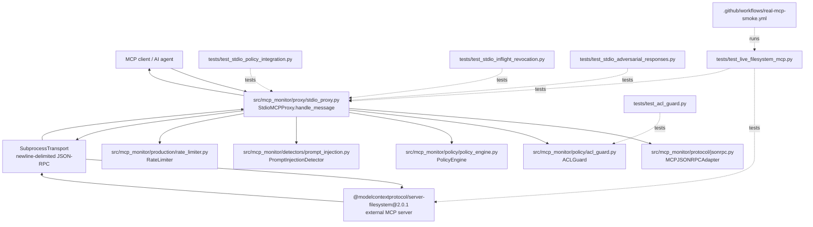

> **Evidence reconciliation (2026-11-11; historical phase/snapshot):** Historical results below retain their original dates and denominators. Latest tested Phase 1–16 development SHA is `43a72c8984bf9a472b9055d4f9e84cc759f61718` ([CI](https://github.com/poojakira/mcp-agent-security-gateway/actions/runs/42971171992): 1,211 passed, 6 skipped per Python version), **not** a merged or production-approved release. Offline research tests require no paid provider or provider-issued API keys; deployed HTTP authentication and unverified real credential revocation remain separate. See [operating restrictions](../../PRODUCTION.md) and [release evidence](../../docs/review/PHASE1_16_RELEASE_CANDIDATE_NO_GO_20261110.md).

# Prototype repository dependency and execution map

> **Evidence boundary (2026-11-09):** The dependency map is illustrative, not a complete static/dynamic import or policy-enforcement proof for every alternate route. [Production release gate](../../docs/review/PHASE13_RELEASE_READINESS.md): **NO-GO**. [Integration candidate](https://github.com/poojakira/mcp-agent-security-gateway/pull/167): draft, unmerged.
This is a **logical module graph for the currently reviewed MCP enforcement path** rather than an exhaustive whole-repository import graph. Arrows labeled `uses` are observed from reviewed source; deployment and documentation nodes describe configuration or verification rather than Python imports.

## Request and response dependency path

1. The client sends JSON-RPC to `StdioMCPProxy.handle_message`.
2. Tool-call validation parses data using `MCPJSONRPCAdapter`; `_inspect` consults trusted `ACLGuard`, `PolicyEngine`, and `PromptInjectionDetector`.
3. Denied calls return security errors **without** sending to `SubprocessTransport`. A permitted call reaches downstream MCP server over stdio.
4. On a tool response, the proxy rechecks protected ACL resource access; an authorization failure suppresses result release.
5. For valid, still-authorized tool results, response shape and prompt-injection checks run before client release. Detector/validation failures block.
6. Test harnesses prove different things: controlled fake transports are not real MCP servers; the real filesystem integration launches a pinned external server and works with disposable files.

## Trust boundaries

- Operator-supplied authenticated principal and ACL grants are authoritative; agent-supplied tool arguments are **not** user identity.
- The subprocess/server response is lower-trust content.
- Policy checks apply only to traffic actually routed through this proxy.
- In-process `ACLGuard` is not a durable multi-node permission service; post-receive ACL recheck is not an atomic serialization with response delivery.
- External `npx` filesystem server is a test dependency, not a server authored by this repository.

## Other project areas

The repository README also documents an HTTP inspection control plane, hash-chained audit/WAL, SIEM/Elastic artifacts, Rust/C++ inspection cores, Docker/Kubernetes templates and other CI jobs. Those exist but are **not asserted as fully traced imports here**. An exhaustive file dependency graph requires enumerating every repository tree entry and resolving language-specific imports, workflows, scripts, images, and dynamic references. Do not interpret this diagram as that inventory.
