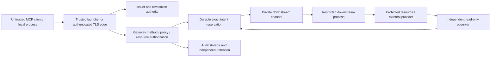

# P0 threat model

Production NO-GO. Two deployment targets remain undecided: offline single trusted host, and networked multi-tenant replicas. Local experiments do not silently substitute for the second target.

Assets: principal/tenant/session authority, ACL ownership, signing keys, operation permits and tombstones, resources, downstream sockets, audit records, approved artifacts. Client arguments, model output, server responses, HTTP headers and success/failure messages are untrusted. Operator provisioning, configuration and independent observer code run in the trusted computing base. A frozen Python dataclass does not protect nested mutable dictionaries; observers now copy their snapshot.

Attackers: malicious clients can replay/mutate messages, substitute tenant/resource and request alternative methods; compromised servers can forge responses and access their allowed resources; untrusted local identities can probe files, executables, sockets and runtime access; network peers can manipulate DNS, redirects and unavailable channels; concurrent/stale replicas can race requests and revocation; storage can corrupt, disappear, fill or roll back. Host root/runtime administrators can bypass local confinement and are not contained by Docker.

Execution inventory:

| Entry/process | Execution authority and exposure |
|---|---|
| `mcp-gateway` / `production/server.py` | HTTP inspection decisions; API key authentication; does not intercept a client's separate tool execution. TLS/tenant identity edge unverified. |
| `proxy/stdio_proxy.py` CLI / library | Starts subprocess or Docker downstream; strict CLI methods bounded; library legacy passthrough separately exposed. Gateway operator controls command, transport and identity bindings. |
| `client.py`, monitor/policy/detection layers | Integrator must honor returned decisions; not an OS execution perimeter. |
| `protected_repo_server.py` | Direct stdio manifest read/update; optional cooperative local authority. Direct same-user invocation is outside a gateway-only perimeter. |
| `proxy/sandbox.py`, `internal_sandbox.py`, `protected_repo_sandbox.py` | Docker client can control downstream containers; daemon access is privileged. No client may receive daemon socket, executable control or writable policy/journal volumes. |
| `defense10/sandbox.py`, realtime/dashboard/workload scripts | Separate research/execution surfaces; never expose as production gateway without dedicated review. |
| `protocol/multiplex.py` | Routes replies, rejects unsolicited messages; gateway supplies authority recheck inside send lock. |

Shared mutable state: ACL snapshots, session/key sets, authority revision high-water marks, process rate/circuit state, intent rows, observation rows, SQLite revocation epochs, file manifests, audit/WAL chains, in-process correlation registries. Local SQLite must reside on one trusted host; independent databases, NFS locking assumptions, restored tombstones and cross-host leader/failover behavior are unverified.

Credential/loading inventory: `production/config.py` environment API key sets, telemetry HMAC salt, webhook URL; local session HMAC/operator-injected JWT/public JWKS; permission-authority key; downstream subprocess environment; Docker operator identities; CI environment credentials. No live private secret store/issuer was inspected. Network destinations include operator webhooks, configured SIEM shipment, downstream internal proxy, build package indexes/registries, public GitHub manifests and advisory databases. Only webhook enforcement is newly strengthened; this is not process-wide egress enforcement.

Important attack paths: direct process bypass; legacy alternate methods; queued stale grants; unauthenticated tenant override; false acknowledgment; duplicate dispatch after lost ACK; cross-workspace observer misassociation; file substitution; stale/replayed snapshot; DNS/proxy/redirect SSRF; artifact substitution and release administrator override. Controls and remaining dependencies are enumerated per finding in the master register.
